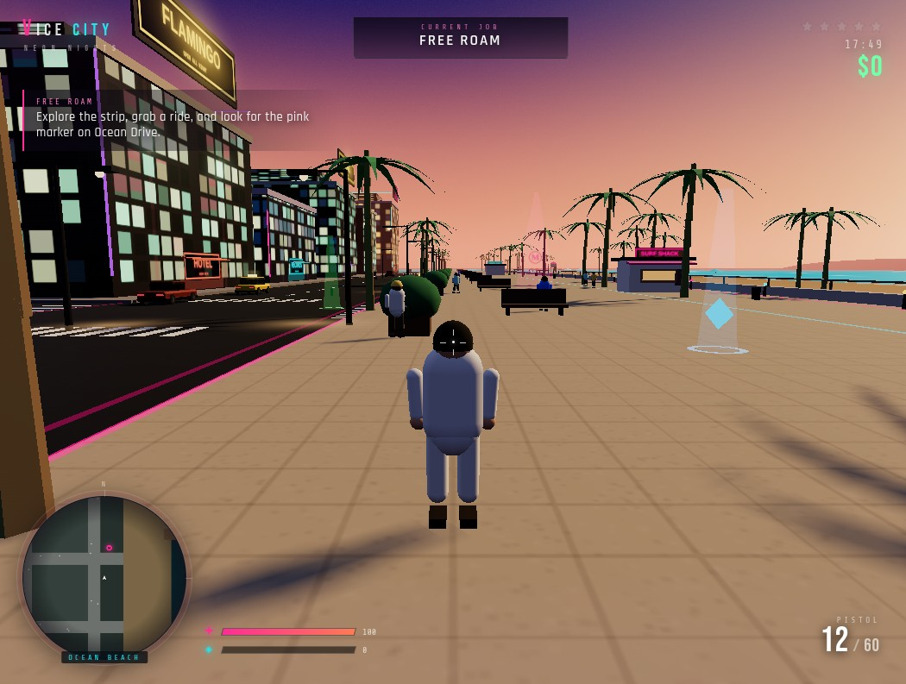

# Vice City — Neon Nights

A playable, open-world third-person action game inspired by 1986 Vice City. Everything is built with **Three.js** and generated at runtime — the city, vehicles, characters, weapons, textures, music and sound effects — so there are no external asset downloads.



## Play

```bash
npm install
npm run dev
```

Open `http://localhost:3002/` and click **Enter Vice City**.

Production build:

```bash
npm run build
npm run preview
```

The build is fully static and works from any subpath (`vite build --base ./`).

## Controls

| Input | On foot | In a vehicle |
| --- | --- | --- |
| `W A S D` | Move | Accelerate / steer / reverse |
| Mouse | Look / aim | Look / orbit camera |
| `Shift` | Sprint | Boost |
| `Space` | Jump | Handbrake |
| `E` | Enter a vehicle / start a job | Exit the vehicle |
| Left mouse | Fire pistol | — |
| `R` | Reload | — |
| `M` | City map | City map |
| `H` | Help / controls | Help / controls |
| `P` / `Esc` | Pause | Pause |

## Features

- **Open-world Ocean Beach** — a 16-block procedural city with art-deco towers, downtown, industrial blocks, a park, plaza, docks, beach promenade, pier, animated ocean and a full day/night cycle.
- **Vehicles** — sports cars, sedans, taxis, vans, pickups and police cruisers with arcade handling, boost, handbrake, traffic AI, parked cars and damage/explosions.
- **Combat & police** — pistol with tracers, muzzle flashes, reloading, health/armor, a five-star wanted system, police pursuit cars and gunfire.
- **Five-mission story** — *Sunset Run*, *Dead Drop*, *Neon Rush*, *Clean Sweep* and *The Big Score*, with timers, markers, enemy waves, escapes and cash rewards.
- **Living streets** — pedestrians that flee and respawn, neon signs, billboards, palms, streetlights, benches, kiosks, umbrellas and pickups.
- **Presentation** — custom sunset/indigo sky shader, bloom, fog, procedural synthwave soundtrack, engine/siren loops and a full HUD with minimap, big map, objective tracker, wanted stars and speedometer.
- **No external assets** — all geometry, textures and audio are generated in code.

## Test / capture URLs

- `?autostart=1` — skip the title screen (used for automated captures).
- `?hour=21.5` — force a time of day from `0` to `23.9` (e.g. sunset at `17.8`, neon night at `21.5`).

## Tech

- [Three.js](https://threejs.org/) (WebGL renderer, EffectComposer, UnrealBloom)
- [Vite](https://vitejs.dev/) for development and static builds
- Vanilla JavaScript modules, Canvas-generated textures, Web Audio synthesis

---

<!-- omgithub:readme:start -->
## 🚀 Build, play, and remix with OMGithub

**Created using [OMGithub.com](https://go.ondev.store/).**

[](https://go.ondev.store/promastore2025-cell/PlayGround)
[](https://github.com/promastore2025-cell/PlayGround)

- 🎮 [Open the project](https://go.ondev.store/promastore2025-cell/PlayGround).
- ✨ [Remix this project](https://go.ondev.store/promastore2025-cell/PlayGround?remix=1).
- 💻 [Explore the source](https://github.com/promastore2025-cell/PlayGround).
- 🛠️ [Check build runs](https://github.com/promastore2025-cell/PlayGround/actions).
- 🐛 [Report an issue](https://github.com/promastore2025-cell/PlayGround/issues).
- 👤 [Explore the creator's projects](https://go.ondev.store/promastore2025-cell).
- 🌍 [Create with OMGithub](https://go.ondev.store/).
<!-- omgithub:readme:end -->
